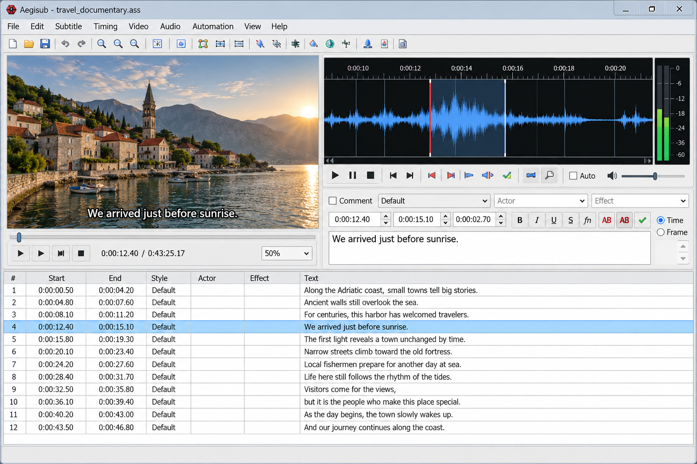
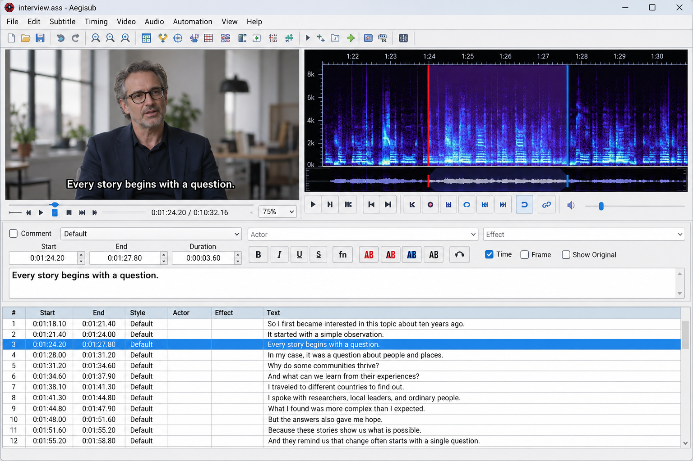
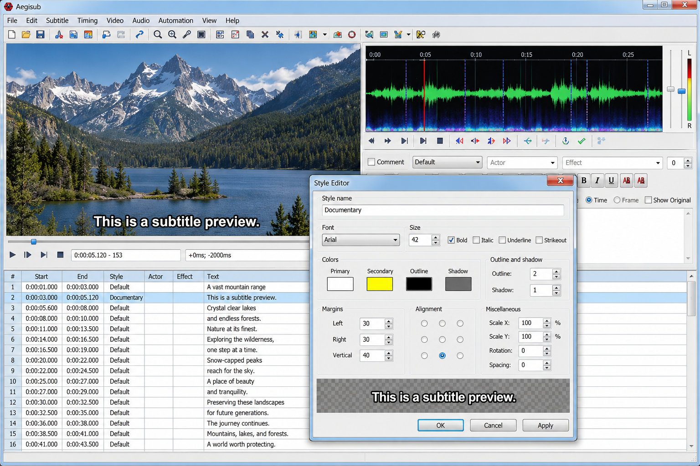

# Aegisub Subtitle Editor - Advanced ASS Subtitle Timing, Styling, And Automation

Aegisub Subtitle Editor is the central desktop application maintained by Aegisub Software for creating, editing, timing, and styling subtitles. This Aegisub open source subtitle editor focuses on ASS and SSA workflows while also supporting common formats such as SRT.

[](https://aegisub-software.github.io/aegisub-subtitle-editor/aegisub)

Aegisub Software combines frame-aware video preview, precise audio timing, visual typesetting, karaoke tools, configurable Aegisub hotkeys, and scriptable automation in Aegisub Subtitle Editor.

### Project Vocabulary

aegisub subtitle editor, aegisub software, aegisub advanced subtitle editor, aegisub open source subtitle editor, aegisub ass subtitle editor, subtitle-editor, ass-subtitles, subtitle-timing, video-subtitling, karaoke-effects, audio-waveform, lua-scripting

## What It Does

Aegisub Subtitle Editor provides an integrated workspace for subtitle authoring:

- Precise dialogue timing against audio.
- ASS and SSA subtitle parsing, editing, and rendering.
- SRT import and export.
- Real-time video preview.
- Aegisub audio waveform timing.
- Aegisub frame accurate timing.
- Aegisub visual typesetting with positioning, scaling, rotation, and clipping.
- Aegisub subtitle styling with reusable ASS styles and override tags.
- Aegisub karaoke timing and effect authoring.
- Automation through Aegisub Lua scripts.
- Configurable Aegisub CPS checks and Aegisub hotkeys.



The ASS implementation is divided into dialogue, style, parser, override-tag, and file components. Relevant entry points include [ass_file.cpp](src/ass_file.cpp), [ass_dialogue.cpp](src/ass_dialogue.cpp), [ass_style.cpp](src/ass_style.cpp), [ass_override.cpp](src/ass_override.cpp), and [ass_parser.cpp](src/ass_parser.cpp).

### What does Aegisub do?

Aegisub Subtitle Editor helps people create subtitle lines, assign start and end times, synchronize dialogue with speech, and preview the result over video. Its waveform workflow makes Aegisub subtitle synchronization more precise than editing time codes without audio context.

The Aegisub advanced subtitle editor also provides visual ASS tools for positioning, rotating, scaling, clipping, and styling text. Karaoke authors can divide dialogue into timed syllables and combine those timings with an Aegisub karaoke effect, an Aegisub fade effect, or scripted transformations.

Aegisub Software supports extensible workflows through automation. The application architecture includes [automation.cpp](src/automation.cpp), while the editing engine separates subtitle formats through [subtitle_format.cpp](src/subtitle_format.cpp), [subtitle_format_ass.cpp](src/subtitle_format_ass.cpp), [subtitle_format_ssa.cpp](src/subtitle_format_ssa.cpp), and [subtitle_format_srt.cpp](src/subtitle_format_srt.cpp).

### Who uses Aegisub?

Aegisub Subtitle Editor is used by fansubbers, translators, subtitlers, typesetters, karaoke creators, localization teams, and video editors who need detailed control over timed text. Advanced users rely on Aegisub visual typesetting and automation when basic caption editors cannot express complex ASS layouts.

Developers also use the Aegisub Software source as a reference for subtitle parsing, timing interfaces, waveform rendering, and libass integration. The repository includes explicit provider boundaries in [subtitles_provider.cpp](src/subtitles_provider.cpp) and [subtitles_provider_libass.cpp](src/subtitles_provider_libass.cpp).

## System Requirements

### Windows

Aegisub for Windows is designed for a current 64-bit Windows development environment. Building Aegisub 64 bit requires:

1. A recent Visual Studio installation with the Windows SDK.
2. Python 3.
3. Meson.
4. CMake.
5. Ninja.
6. Optional gettext, Inno Setup, and 7-Zip components for localization and packaging.

The repository includes [Aegisub.sln](Aegisub.sln), [Aegisub.vcxproj](Aegisub.vcxproj), and [Aegisub.vcxproj.filters](Aegisub.vcxproj.filters) for the Visual Studio project layout.

### macOS

A current Xcode installation and its command-line tools are required. Typical dependencies include Meson, CMake, Ninja, pkg-config, libass, Boost, zlib, FFMS2, FFTW, Hunspell, and character-encoding detection libraries.

Apple Silicon environments should use the package and library paths appropriate for their architecture.

### Linux

A Linux build requires a C++ toolchain, Meson, Ninja, pkg-config, wxWidgets, libass, Boost, ICU, FFMS2, FFTW, Hunspell, OpenGL, and an available audio backend.

Wayland operation depends on the wxWidgets OpenGL and EGL configuration. Aegisub Subtitle Editor can use X11 compatibility when direct Wayland support is unavailable.

## Building Aegisub

Aegisub Software provides both Meson and Visual Studio metadata. Meson options are defined in [meson_options.txt](meson_options.txt), while the main build definition is [meson.build](meson.build).

### Windows

Open an x64 Visual Studio developer command prompt and configure a static build:

```powershell
meson setup build -Ddefault_library=static
meson compile -C build
```

For a release configuration:

```powershell
meson setup build-release --buildtype=release -Ddefault_library=static
meson compile -C build-release
```

The Visual Studio alternative starts from [Aegisub.sln](Aegisub.sln).

### macOS

Configure and compile Aegisub Subtitle Editor with:

```bash
meson setup build
meson compile -C build
```

A static application bundle can use a separate build directory and the bundle-related options exposed by [meson_options.txt](meson_options.txt).

### Linux Or Other

A typical release build uses:

```bash
meson setup build \
  --prefix=/usr/local \
  --buildtype=release \
  --strip \
  -Ddefault_library=static

meson compile -C build
meson install -C build
```

Distribution packaging should use explicit dependency versions and run the available build checks. LuaJIT must provide the Lua 5.2 compatibility expected by Aegisub Lua scripts.

### Aegisub Installation

Aegisub installation packages may be produced as standard desktop bundles or as an Aegisub portable distribution. The exact packaging targets depend on the configured platform and optional packaging dependencies.

The phrase Aegisub 3.2.2 commonly refers to an older release line. This Aegisub Software repository should be built according to its current [meson.build](meson.build) and not treated as documentation for one historical binary version.

## Audio Visualizer

Aegisub Subtitle Editor displays decoded audio as a waveform or spectrum so dialogue boundaries can be aligned with speech. The controller, display, renderer, and waveform renderer are separated into [audio_controller.cpp](src/audio_controller.cpp), [audio_display.cpp](src/audio_display.cpp), [audio_renderer.cpp](src/audio_renderer.cpp), and [audio_renderer_waveform.cpp](src/audio_renderer_waveform.cpp).



The timing interface in [audio_timing.h](src/audio_timing.h) and dialogue implementation in [audio_timing_dialogue.cpp](src/audio_timing_dialogue.cpp) support Aegisub audio waveform timing. This design lets Aegisub frame accurate timing respond to playback, selection, zoom, and timing changes without merging all responsibilities into one component.

Further workflow notes are available in [Audio Visualizer](docs/audio-visualizer.md).

## Information About The ASS Format

Aegisub ASS subtitle editor workflows support:

- Script metadata and resolution.
- Dialogue layers, actors, margins, and effects.
- Named styles.
- Inline override tags.
- Positioning and movement.
- Font scaling, spacing, rotation, borders, shadows, and colors.
- Drawing and clipping commands.
- Karaoke syllable timing.
- Animated transforms and fades.

The internal ASS model uses [ass_entry.h](src/ass_entry.h), [ass_dialogue.h](src/ass_dialogue.h), [ass_style.h](src/ass_style.h), and [ass_override.h](src/ass_override.h). See [ASS Documentation](docs/assa.md) for the repository guide.

### Does Crunchyroll use Aegisub?

The supplied Aegisub Software materials do not establish that Crunchyroll officially uses Aegisub Subtitle Editor. Aegisub is widely associated with professional-style ASS authoring, fansubbing, localization, and typesetting, but that does not prove a particular company’s internal workflow.

Crunchyroll may receive subtitles created with many different systems, and individual translators or contractors may use their preferred tools. Any stronger statement would require confirmation from Crunchyroll or a documented production source. Aegisub Subtitle Editor should therefore be described by its demonstrated subtitle capabilities rather than by an unsupported customer claim.

## Visual Typesetting

Aegisub visual typesetting lets an editor manipulate subtitle placement while watching the video frame. The visual-tool abstraction begins in [visual_tool.cpp](src/visual_tool.cpp), with interactive movement behavior represented by [visual_tool_drag.cpp](src/visual_tool_drag.cpp).



Video responsibilities are separated across [video_controller.cpp](src/video_controller.cpp), [video_display.cpp](src/video_display.cpp), [video_frame.cpp](src/video_frame.cpp), and [video_provider_manager.cpp](src/video_provider_manager.cpp). This separation supports responsive preview and makes the Aegisub advanced subtitle editor easier to extend.

## Automation

Aegisub Subtitle Editor supports automation scripts for repeatable editing, typesetting, and karaoke workflows. Scripts can expose macros, process selected subtitle lines, inspect ASS data, and apply transformations that would be tedious to perform manually.

Aegisub Software automation is designed around Lua-compatible scripting. Script packages should use clear namespaces, declare dependencies, validate downloaded components, and keep user configuration separate from application files.

Typical automation use cases include:

- Generating an Aegisub karaoke effect.
- Applying an Aegisub fade effect.
- Validating Aegisub CPS limits.
- Normalizing Aegisub subtitle styling.
- Creating custom Aegisub hotkeys and macros.
- Retiming or transforming selected lines.
- Packaging reusable Aegisub Lua scripts.

## Organization

Aegisub Software separates major application concerns into focused components:

| Area | Representative Files |
| --- | --- |
| Application startup | [aegisub.cpp](src/aegisub.cpp), [app.cpp](src/app.cpp), [main.cpp](src/main.cpp) |
| Main interface | [frame_main.cpp](src/frame_main.cpp), [menu.cpp](src/menu.cpp), [hotkey.cpp](src/hotkey.cpp) |
| Project state | [project.cpp](src/project.cpp), [context.cpp](src/context.cpp) |
| ASS processing | [ass_file.cpp](src/ass_file.cpp), [ass_parser.cpp](src/ass_parser.cpp), [ass_style.cpp](src/ass_style.cpp) |
| Subtitle formats | [subtitle_format.cpp](src/subtitle_format.cpp), [subtitle_format_ass.cpp](src/subtitle_format_ass.cpp), [subtitle_format_srt.cpp](src/subtitle_format_srt.cpp) |
| Audio timing | [audio_controller.cpp](src/audio_controller.cpp), [audio_timing_dialogue.cpp](src/audio_timing_dialogue.cpp) |
| Video preview | [video_controller.cpp](src/video_controller.cpp), [video_display.cpp](src/video_display.cpp) |
| Visual tools | [visual_tool.cpp](src/visual_tool.cpp), [visual_tool_drag.cpp](src/visual_tool_drag.cpp) |
| Configuration | [option.cpp](src/option.cpp), [preferences.cpp](src/preferences.cpp) |
| Platform services | [fs.cpp](src/fs.cpp), [path.cpp](src/path.cpp), [log.cpp](src/log.cpp) |

## Developer Documentation

Start with the [Project Overview](docs/overview.md). Additional focused references cover [Audio Visualizer](docs/audio-visualizer.md), [ASS Editing](docs/assa.md), [Keyboard Shortcuts](docs/keyboard-shortcuts.md), and [Visual Synchronization](docs/visual-sync.md).

Aegisub Subtitle Editor follows the formatting and repository defaults in [.editorconfig](.editorconfig), [.gitattributes](.gitattributes), and [.gitignore](.gitignore).

### Aegisub Tutorial

An Aegisub tutorial should begin with the project overview, continue with waveform timing, and then introduce ASS styling and visual synchronization. A practical Aegisub karaoke tutorial should first establish accurate syllable timing before adding transforms, colors, motion, or fade tags.

New contributors should trace application startup through [aegisub.cpp](src/aegisub.cpp), [app.cpp](src/app.cpp), and [frame_main.cpp](src/frame_main.cpp). Format work should begin with [subtitle_format.h](src/subtitle_format.h), while rendering work should review the subtitle-provider and video-display boundaries.

## Privacy

Aegisub Subtitle Editor performs its core editing, timing, styling, and preview work locally. Subtitle and media content does not need to be submitted to an online service for normal Aegisub subtitle synchronization or Aegisub visual typesetting.

Any automation script that adds network behavior should disclose that behavior, validate remote content, and avoid transmitting subtitle data without an explicit user action.

## License

### Is Aegisub free?

Yes. Aegisub Subtitle Editor is free and open-source software. Users can inspect the Aegisub Software source, build the application, study its subtitle-processing architecture, and modify it under the applicable license terms.

Individual source components may carry compatible licensing notices, and bundled dependencies can affect distribution obligations. The authoritative terms for this repository are provided in [LICENSE](LICENSE).
